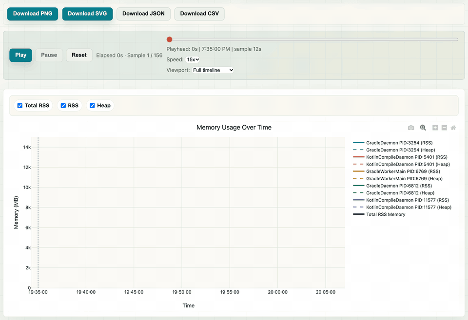
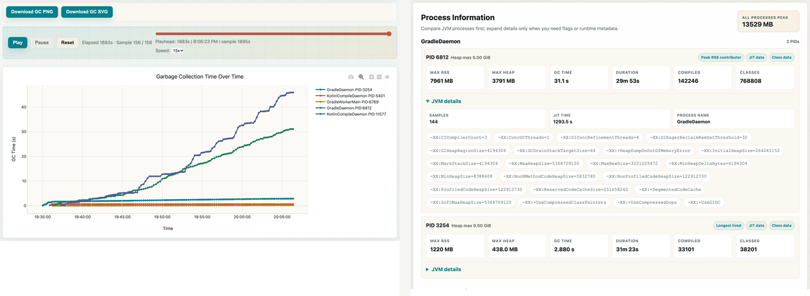
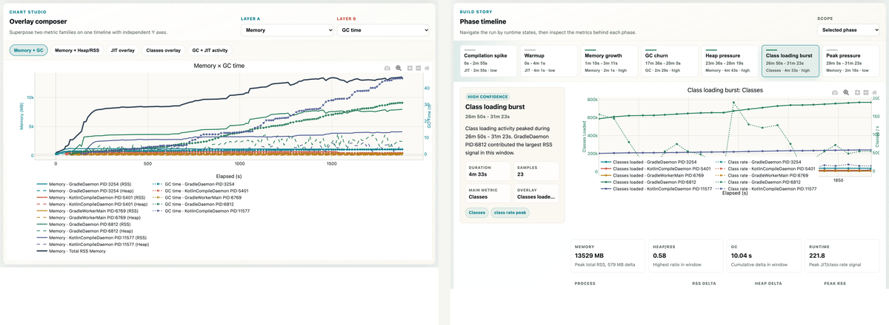
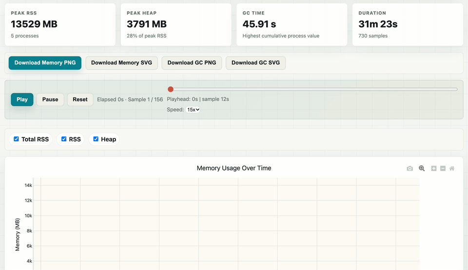
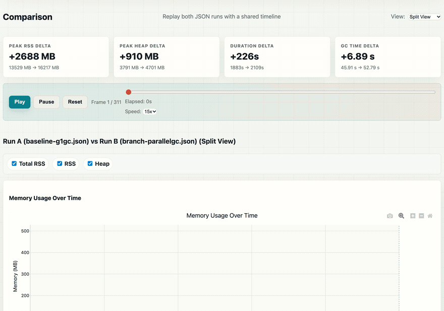
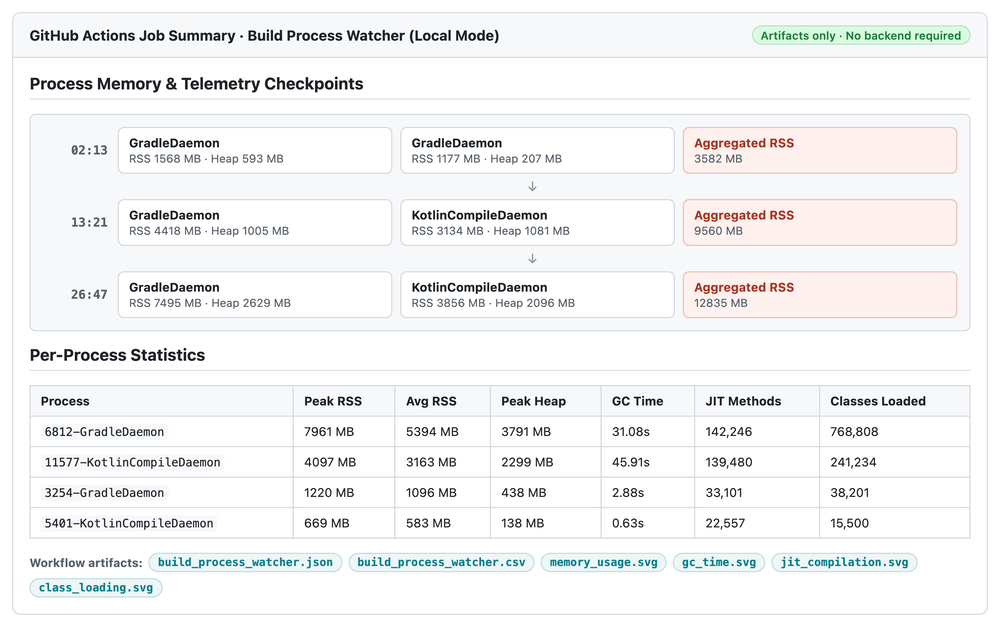
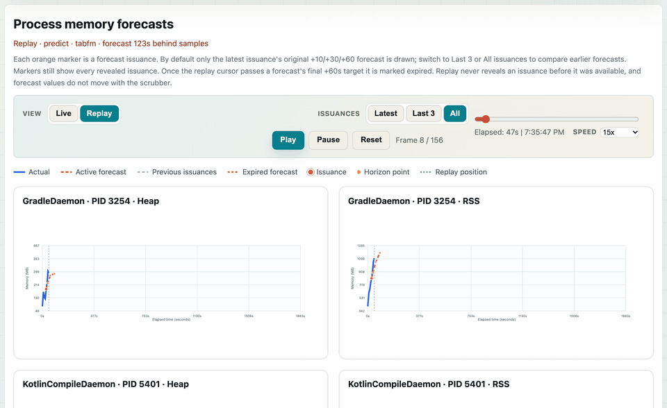

# Build Process Watcher

[](https://github.com/marketplace/actions/build-process-watcher)
[](https://process-watcher.web.app/runs/demo.html)

Monitor Java/Kotlin build processes (`GradleDaemon`, `GradleWorkerMain`, `KotlinCompileDaemon`) in GitHub Actions. Track heap, RSS, garbage collection, JIT compilation, class loading, and VM flags without injecting a Java agent or changing JVM launch arguments.

<p align="center">
  
</p>

## Quick Start

> **Unreleased development ref:** Snippets below pin [`88f0d0b85857dd71009cf827564fb33d75769214`](https://github.com/cdsap/build-process-watcher/commit/88f0d0b85857dd71009cf827564fb33d75769214) for the upcoming **v0.8.0 (unreleased)** inputs (`prediction_mode`, `prediction_target`, `prediction_throttle_s`). Published `v0.7.0` does not support these inputs; see [release validation](RELEASE_NOTES.md#release-validation). Root action only (`/start` and `/composite` accept only `interval`).

### Local Mode (Artifacts Only)

```yaml
- uses: cdsap/build-process-watcher@88f0d0b85857dd71009cf827564fb33d75769214
```

### Remote Mode (Live 24h Dashboard)

```yaml
- uses: cdsap/build-process-watcher@88f0d0b85857dd71009cf827564fb33d75769214
  with:
    remote_monitoring: 'true'
```

### Optional BigQuery Export

```yaml
- uses: cdsap/build-process-watcher@88f0d0b85857dd71009cf827564fb33d75769214
  with:
    remote_monitoring: 'true'
    export_to_bigquery: 'true'
```

### Timeline Prediction (Experimental)

```yaml
- uses: cdsap/build-process-watcher@88f0d0b85857dd71009cf827564fb33d75769214
  with:
    prediction_mode: 'predict'
    prediction_throttle_s: '20'
```

## Views & Tools

| Surface | Preview | Notes |
| --- | --- | --- |
| **Run Dashboard** ([Demo](https://process-watcher.web.app/runs/demo.html)) |  | Heap, RSS, GC, JIT (`jstat -compiler`), class loading (`jstat -class`), and JVM flags. |
| **Studio & Build Story** |  | Dual-axis overlays (`Memory × GC`) and auto-detected build phases. |
| **Replay** ([Open](https://process-watcher.web.app/replay.html)) |  | Scrub any exported `build_process_watcher.json` offline (no Remote Mode needed). |
| **Compare** ([Open](https://process-watcher.web.app/compare.html)) |  | Delta KPIs, shared-scale Side-by-Side or Split timelines, and GC/VM flag diff. |
| **Local CI Summary** |  | Mermaid checkpoints, per-process stats table, SVG charts, CSV, and JSON artifacts. |
| **Predictions (Experimental)** |  | Opt-in `+10/+30/+60s` memory and `+60s` class-loading overlays (`process_forecasts`). |

## Inputs

| Input | Description | Default |
| --- | --- | --- |
| `collector` | `shell` or experimental `daemonitor` collector | `shell` | No |
| `daemonitor_bin_dir` | Directory containing both native Daemonitor executables | — | With `collector: daemonitor` |
| `daemonitor_source_commit` | Verify a full source commit and binary hashes using `build-info.json` | — | No |
| `remote_monitoring` | Enable live cloud dashboard (24-hour retention). Set `BACKEND_URL` / `FRONTEND_URL` env vars for custom hosts. | `false` |
| `run_id` | Custom run identifier. | Auto-generated |
| `log_file` | Local log filename. | `build_process_watcher.log` |
| `interval` | Polling interval in seconds. | `5` |
| `debug` | Enable debug logging and include `backend_debug*.log` / `script_debug*.log` in artifacts. | `false` |
| `disable_summary_output` | Suppress GitHub Actions job summary when Remote Mode is enabled. | `false` |
| `export_to_bigquery` | Optional finished-run export to BigQuery (requires Remote Mode and `BIGQUERY_EXPORT_DATASET` on backend). | `false` |
| `prediction_mode` | `disabled`, `forecast`, `predict`, `bqml-boosted`, or `tabpfn`. Active modes enable Remote Mode (not BigQuery export). | `disabled` |
| `prediction_target` | `memory` (default), or experimental `class_loading` with `predict`, `forecast`, or `tabpfn`. | `memory` |
| `prediction_throttle_s` | Forecast issuance cadence in elapsed seconds (`1–3600`), separate from `interval`. | `20` |
| `freshness_diagnostics` | Opt-in collection-to-dashboard timing telemetry; enables Remote Mode. | `false` |

## Prediction Modes (Experimental)

**Prediction mode selection:** `prediction_mode` is disabled by default; active modes automatically enable Remote Mode without enabling `export_to_bigquery`. Selecting a mode requests a provider and does not guarantee availability or inference.

| Mode | Model / behavior | Availability |
| --- | --- | --- |
| `disabled` / omitted | No prediction request | Default; local monitoring remains possible |
| `forecast` | TimesFM time-series forecasts | Requires the configured hosted provider |
| `predict` | TabFM tabular prediction; distinct from TabPFN | Requires the configured hosted provider |
| `bqml-boosted` | Trained BigQuery ML boosted-tree forecasts | Requires the configured trained-model provider (memory only) |
| `tabpfn` | TabPFN GPU inference on a VM | **TabPFN is disabled by default; available only when its VM/provider is available.** Selecting the input does not start the VM or guarantee forecasts. |

- **Class-loading target (`prediction_target: class_loading`):** Predicts additional classes loaded over `+60s` for `GradleDaemon` and `KotlinCompileDaemon` (supported with `predict`, `forecast`, or `tabpfn`). See the [prediction guide](docs/prediction.md), [forecast guide](docs/forecast-guide.md), and [class-loading contract](docs/class-loading-prediction.md).

## Outputs

| Mode | Generated outputs |
| --- | --- |
| **Local Mode** | `build_process_watcher.json` (Replay/Compare), `build_process_watcher.csv`, `build_process_watcher.log`, `memory_usage.svg`, `gc_time.svg`, `jit_compilation.svg`, `class_loading.svg`, and GitHub Actions job summary. |
| **Remote Mode** | Live dashboard URL (24-hour retention), real-time memory/GC/JIT/class telemetry, plus job summary (unless `disable_summary_output: 'true'`). |

Missing or unsupported `jstat` counters are recorded as `null` without affecting memory or GC collection. Benchmark local `jstat` overhead with `scripts/benchmark-jstat-metrics.sh <pid>`.

## Local CI Testing & Architecture

```bash
act -W .github/workflows/test-action-local.yml -j local-mode
```

- **Frontend:** Firebase Hosting (`frontend/public/`, static HTML/CSS/JS + Plotly)
- **Backend:** Google Cloud Run (Go API, built with Bazel)
- **Storage:** Firestore (24-hour TTL) + optional BigQuery finished-run export

## License

MIT

### Compare collectors on the same build

The default shell collector is unchanged. Select `collector: daemonitor` to use the native CLI installed with `brew install cdsap/tap/daemonitor-cli` while BPW continues to own authentication, local reports, backend uploads, and run completion. The comparison workflow uses Daemonitor 1.3.3: [install the CLI and run both variants](docs/testing/collector-comparison.md).

The manual **Compare BPW collectors** workflow resolves one workload commit and runs the same command in separate `shell` and `daemonitor` jobs. Each has its own run ID and artifacts. Remote monitoring and BigQuery export remain optional.
