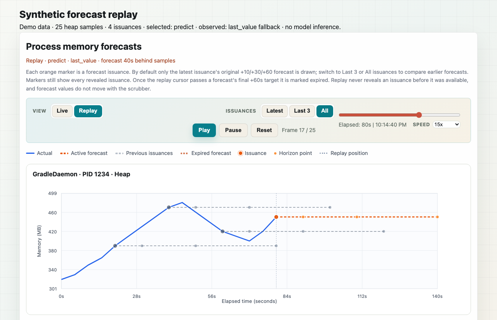
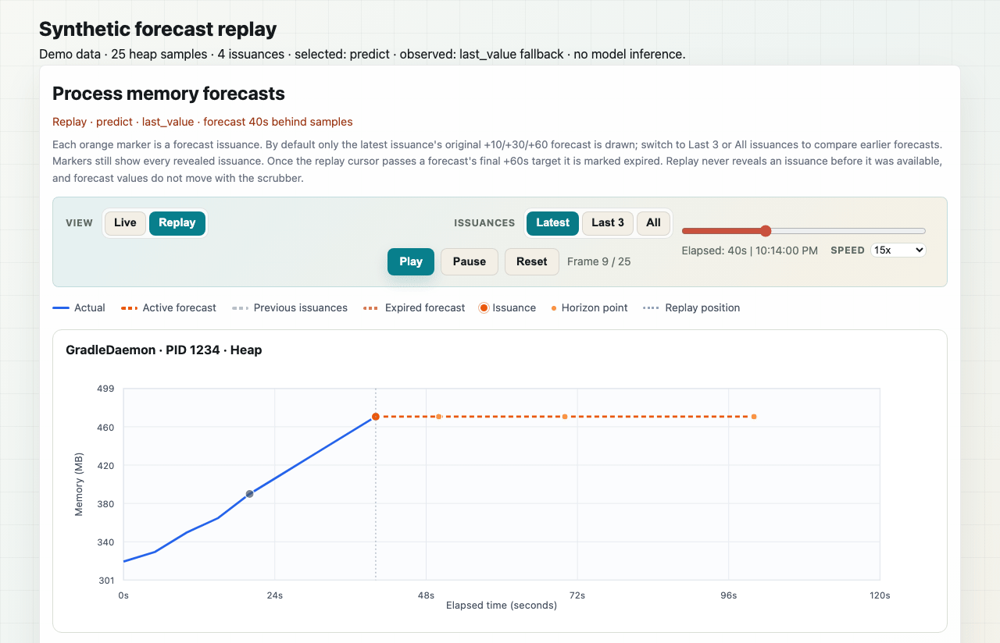

# Timeline forecasts: examples and verification

Timeline modes request per-process memory values at fixed future timestamps.
They are experimental. A successful build or advancing actual-memory chart does
not prove that a prediction provider ran.

## Choose an action ref that accepts the inputs

As checked on 2026-11-21, the [latest published release, v0.7.0](https://github.com/cdsap/build-process-watcher/releases/tag/v0.7.0),
contains the older `predictive_reliability` input. Its
[action metadata](https://github.com/cdsap/build-process-watcher/blob/v0.7.0/action.yaml)
does **not** accept `prediction_mode` or `prediction_throttle_s`. Do not use
those inputs with that release or interpret ignored inputs as working forecasts.

This example selects the public commit
[`88f0d0b85857dd71009cf827564fb33d75769214`](https://github.com/cdsap/build-process-watcher/commit/88f0d0b85857dd71009cf827564fb33d75769214),
whose metadata and committed action bundle accept timeline inputs. It is a
commit pin, not a newer tagged release:

```yaml
- uses: cdsap/build-process-watcher@88f0d0b85857dd71009cf827564fb33d75769214
  with:
    prediction_mode: 'predict'
    prediction_throttle_s: '20'
```

`prediction_mode` selects `disabled` (default), `forecast`, `predict`,
`bqml-boosted`, or `tabpfn`. Timeline modes imply Remote Mode, independently of
BigQuery export. `prediction_throttle_s` defaults to `20`, with integer range
`1`–`3600`. It sets elapsed-time buckets for scheduling/evaluation, not a promise
that a new forecast arrives every 20 seconds. Scheduler/provider availability
and inference delay affect what is actually stored.

The selected mode/output is a request. Inspect each issuance's `method` and
`fallback` to establish what happened. An observed `last_value` method or
`fallback: true` is not primary model inference. A model name shown from the
mode catalog, without observed method evidence, is not proof of execution.
Missing forecasts can coexist with healthy ingestion. See the
[operator guide](prediction-job-offload.md) for scheduler/provider diagnosis.
TabPFN examples apply only when its VM is already available; do not start the VM
for documentation checks or require it as an always-on dependency.

## A reproducible synthetic replay

The [JSON fixture](examples/process-forecasts.json) contains one synthetic
GradleDaemon PID, 25 heap samples at five-second intervals, and four deliberately
flat last-value fallback issuances at elapsed 20/40/60/80 seconds. It has no
customer data, training rows, endpoints, or real provider results. Timing and
model-version fields are intentionally absent. RSS is absent too: missing
metrics are valid, and only observed process/metric combinations are plotted.

From the repository root, serve files locally:

```bash
python3 -m http.server 8765 --bind 127.0.0.1
```

Open <http://127.0.0.1:8765/docs/examples/forecast-demo.html>. The demo uses the
current dashboard's CSS, renderer, playback clock, and controls directly. It
fetches only the local fixture; it never requests inference. Remove
`process_forecasts` to inspect legacy input: actual samples remain valid and
there are no forecast overlays. Missing latency fields mean unavailable timing,
not zero latency. See the [contract](process-forecast-contract.md) for units,
metric mapping, optional fields, and actual matching.



Synthetic data, selected mode `predict`, observed method `last_value`, four
fallback issuances, no model inference. At 80s the latest issuance is 450 MB
at +10/+30/+60, targeting elapsed 90/110/140s. Scrubbing to 90s leaves those
values and targets fixed. The blue actual line advances as observations are
revealed; no forecast follows the replay cursor.



Latest draws one revealed issuance, Last 3 up to three, and All every revealed
issuance. All revealed orange issuance markers remain visible in each setting.
Future issuances stay hidden until their creation time; an issuance expires
once replay passes its last target. This capture uses the current UI without
flashing issuance callouts.

[Mobile capture at 390px](media/forecast-replay-mobile.png): the toolbar wraps,
and controls remain usable. The current chart scales its SVG labels down on a
narrow display; use desktop rendering for detailed axis/hover inspection.

The fixture has 25 observed samples and four issuances; these are different
counts. The current horizon summary matches 4/4/3 targets at +10/+30/+60 using
the nearest actual within ±10 seconds. The final +60 target is beyond the sample
range. Summary `n` counts matched targets per horizon across stored history,
not training rows or the currently drawn issuance subset. Any displayed errors
are arithmetic on synthetic data, with no accuracy or model-comparison claim.

## Verification record (2026-11-21)

- **Source and snippet compatibility:** public pinned `action.yaml` checked
  against both inputs and defaults. The downloaded public
  [`dist/index_with_backend.js`](https://github.com/cdsap/build-process-watcher/blob/88f0d0b85857dd71009cf827564fb33d75769214/dist/index_with_backend.js)
  matched the local committed artifact: SHA-256
  `7a7911bdedbb9b767f1cfa139e218bc6eb110a7e89a5810d9df2938e02cd2ca1`.
  Its input parser and mode/throttle validation are present. This establishes
  artifact input support, not execution of a hosted workflow.
- **Local tests:** 46 tests pass across prediction-view, prediction-mode-boundary,
  and action-config. They cover the fixture, optional fields, legacy runs, fixed
  targets, history counts, and action configuration. No action bundle or backend behavior changed.
- **Rendered UI:** Chromium desktop 1280px and mobile 390px; Latest/Last 3/All
  counts 1/3/4; timeline scrubbing; Play/Pause/Reset; speed selection; no page
  errors or mobile document overflow. Media omits catalog diagnostics and
  synthetic error tables to avoid implying inference or accuracy evidence.
  Regenerate with `node docs/examples/capture-forecast-demo.cjs` after installing
  the repository's existing npm/browser dependencies; GIF capture also needs
  `ffmpeg`. Relative guide/demo/media links are checked locally.
- **Publication/live page:** not performed. This task authorizes isolated local
  edits only. After an authorized publication, open the exact deployed guide
  and demo URLs, record deployment/ref and date, verify image/GIF requests,
  navigation, mobile layout, and history controls again. Local media does not
  establish that the deployed page has changed.
- **Provider inference:** not exercised; no provider execution evidence is
  available for this docs run. Synthetic fallback rendering is not a successful
  model invocation. Report an unavailable provider path separately from source
  or UI success. No TabPFN VM was started.

The [tester scenarios](testing/the-tester.md) define remote evidence collection.
The dated [reliability plan](plans/2026-07-18-001-feat-private-predictive-reliability-plan.md)
and [provider integration plan](plans/2026-07-20-001-feat-private-predictor-provider-integration-plan.md)
are historical design records. Use the current contract and tester scenarios
for timeline runs rather than their reliability checkpoint assumptions.
