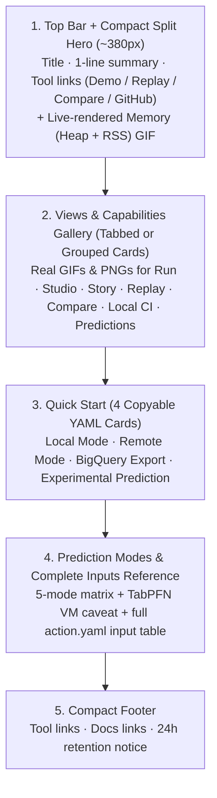

# Spike: Modernize Public Web Homepage & Shorten README

**Date:** 2026-11-24 · **Baseline:** `cdsap/build-process-watcher` `main` (`53aa7d1`)

> [!NOTE]
> The public website (`https://process-watcher.web.app/`) is served from `frontend/public/` via **Firebase Hosting** (`firebase.json`); there is no separate `gh-pages` branch in the repository. Modernizing `frontend/public/index.html` and its media assets updates the live site directly on deploy.

---

## 1. Decisions & Goals

Replace the marketing-heavy landing page in `frontend/public/index.html` and the 259-line `README.md` with a **tool-first, engineering-focused showcase** that reflects what Build Process Watcher actually ships today:

1. **Less marketing, more real product:** Remove the `92vh` dark billboard hero, oversized display slogans, and 3x duplicated feature card grids. Put the real dashboard UI, live tools (`Demo`, `Replay`, `Compare`), and copyable snippets front and center.
2. **Real GIFs & screenshots for every major view/option:** Show Classic Run Dashboard (Memory/Heap+RSS, GC, JIT, Classes, Process Info), Studio Overlay, Build Story, Replay, Compare (delta KPIs + Side-by-Side + Split), Local CI Summary, and Experimental Predictions (Memory & Class Loading).
3. **Replace legacy GIFs cleanly:** Delete the old bloated root GIFs (`frontend/public/performance.gif` 1.4 MB, `reply.gif` 3.8 MB, duplicate `replay.gif` 3.8 MB, `compare.gif` 3.3 MB — **12.3 MB** total in repo) and store all new lightweight PNGs (`<= 160 KB`) and Lanczos-downscaled, palette-optimized GIFs (`<= 450 KB` each) under `frontend/public/media/`.
4. **Shorter, sharper `README.md`:** Cut from **259 lines -> ~120 lines** by dropping the unused `predictive_reliability` migration section (updating the 3 tests asserting it), consolidating all inputs into one table, moving the orphaned post-License `class_loading` section into its proper place, and linking deep-dive docs instead of repeating them inline.

---

## 2. Current Baseline Audit (`53aa7d1`)

| Surface | Current Problems |
| --- | --- |
| **`frontend/public/index.html`** (846 lines) | • `92vh` dark hero (`7.6rem` H1, decorative 2x2 buzzword box, blurred `1.4 MB` outdated `performance.gif`) hides actual content below the fold. • Repeats Run / Replay / Compare / BigQuery **three separate times** (`#whats-new`, `#analysis-tools`, and numbered `01-04` `Workflow` cards) plus a redundant bottom CTA banner. • Only shows 2 outdated GIFs (`reply.gif`, `compare.gif` = 7.1 MB combined); zero visuals for Run Dashboard, Studio, Build Story, Predictions, or Local CI artifacts. • `<meta name="description">` inaccurately claims **"CPU"** (BPW tracks RSS, Heap, GC, JIT, Classes — not CPU). • Line 694 renders raw Markdown backticks `` `export_to_bigquery` `` as literal text inside HTML. • Inputs table omits `prediction_target` and `freshness_diagnostics`. |
| **`README.md`** (259 lines) | • Heavy release/migration prose (including a 27-line `predictive_reliability` migration section) before a clean Quick Start. • Repeats `export_to_bigquery`, `prediction_mode`, `prediction_throttle_s`, and `TabPFN` caveats 3-4 times across Quick Start, Migration, Inputs, and the bottom appendix. • `Class-loading activity experiment` is tacked on **after `## 📝 License`** (lines 247-259). • Uses stale GIFs (`performance.gif`, `reply.gif`, `compare.gif`) and an older `svg-chart-example.png`. |
| **Media in `frontend/public/`** | • `reply.gif` (3.8 MB) and `replay.gif` (3.8 MB) are byte-identical duplicates. • Total homepage GIF payload is **8.5 MB** on initial load (no `loading="lazy"`), with **12.3 MB** of stale GIFs checked into `frontend/public/`. |

---

## 3. Proposed Homepage Structure (`frontend/public/index.html`)

Preserve the static HTML/CSS/JS architecture and `bpw-ui.css` operational palette (paper background, crisp bordered cards, teal/coral accents), collapsing 8 repetitive sections into **5 focused tool sections**:

### Section-by-Section Blueprint

1. **Top Nav + Compact Split Hero (Light, Tool-First — no `92vh` dark billboard)**
   - Standard sticky header matching `bpw-ui.css` (`Build Process Watcher` + `Demo`, `Replay`, `Compare`, `Docs`, `GitHub`).
   - Two-column compact hero:
     - **Left:** Operational headline (`Monitor Gradle & Kotlin JVM build processes in CI`), 2-sentence description (Heap, RSS, GC, JIT, Class Loading — no Java agent, works offline or live), direct action buttons (`Open Demo`, `Replay JSON`, `Compare Runs`), and compact version/ref pill.
     - **Right:** Crisp lightweight GIF of the real **Memory Usage Over Time (Heap + RSS)** panel (`~330 KB`, `960x700`).

2. **Interactive Feature & View Gallery (`#views` — Real Screens & GIFs)**
   - Replace `#whats-new`, `Workflow 01-04`, and `Screens` with one crisp, tabbed (or grouped) visual showcase covering **every actual capability**:
     - **Run Dashboard (Classic):** Animated GIF of Memory (Heap + RSS) replay + screenshot of GC / JIT / Classes / Process Info & VM flags.
     - **Studio & Build Story:** Screenshot of Studio dual-axis overlay (`Memory x GC`) + Screenshot of Build Story auto-detected phases.
     - **Replay (Offline JSON):** Animated GIF showing one-click demo/dropzone, KPI summary strip, speed controls (`5x-50x`), and scrubbing.
     - **Compare (2 Builds):** Animated GIF showing top delta KPI strip, shared Y-axis Side-by-Side vs Split View, and GC flag diff.
     - **Local Mode (CI Artifacts):** Screenshot of GitHub Actions Job Summary (Mermaid timeline + per-process table) + exported SVG chart.
     - **Predictions (Experimental):** Animated GIF of Memory (`+10/+30/+60s`, All issuances) and screenshot of Class Loading (`+60s`), explicitly badged `Experimental` with concise advisory disclaimer.
   - Each card includes a direct action link (`Open Demo`, `Open Replay`, `Open Compare`, `Prediction guide`).

3. **Quick Start (`#quick-start` — 4 Compact YAML Snippets)**
   - 2x2 grid of clean, copy-ready YAML snippets pinned to the same verified ref:
     1. **Local Mode** (artifacts only: JSON, CSV, SVGs, Job Summary)
     2. **Remote Mode** (live 24h dashboard)
     3. **BigQuery Export** (optional finished-run export; requires Remote Mode)
     4. **Timeline Prediction (Experimental)** (`prediction_mode` + optional `prediction_target: class_loading`)
   - Single concise unreleased-ref notice at the top of the section (not repeated inside every card).

4. **Inputs & Prediction Modes (`#prediction` & `#inputs`)**
   - Keep the exact public 5-mode table (`disabled`, `forecast`, `predict`, `bqml-boosted`, `tabpfn`) with the TabPFN VM caveat right beside it.
   - Single complete **Inputs** table matching `action.yaml` (adding `prediction_target`, `freshness_diagnostics`, `run_id`, `log_file`, `debug`).

5. **Compact Footer**
   - Remove the redundant bottom `"Open a real dashboard"` CTA banner; keep a crisp footer with `Demo`, `Replay`, `Compare`, `Docs`, `GitHub`, and the 24h retention note.

---

## 4. Proposed `README.md` Structure (~259 lines -> ~120 lines)

Make `README.md` scannable in 60 seconds while keeping every technical contract accurate:

| Proposed Section | Target Length | What Changes vs. Current README |
| --- | --- | --- |
| **Title + Badge + Hero GIF + 2-line pitch** | ~10 lines | Swap stale 1.4 MB `performance.gif` for crisp ~330 KB `frontend/public/media/run-memory-replay.gif`; drop fluff. |
| **Quick Start** (Local, Remote, BigQuery Export, Experimental Prediction) | ~35 lines | Single 2-line unreleased-ref/v0.7.0 note at top; 4 tight YAML blocks; remove the unused `predictive_reliability` migration block (update tests accordingly). |
| **Views & Visual Tour** | ~15 lines | Compact 2-column Markdown table of real screenshots/GIFs: **Run Dashboard**, **Replay**, **Compare**, **Studio / Story**, **Predictions (Experimental)**, **GitHub Actions Summary**. |
| **Inputs** | ~20 lines | Single complete 11-row table (`remote_monitoring` ... `freshness_diagnostics`). Delete the repetitive prose paragraphs underneath; link `docs/prediction.md` and `docs/class-loading-prediction.md`. |
| **Prediction Modes (Experimental)** | ~15 lines | Compact 5-row mode matrix + 2-line note on `prediction_target: class_loading` (moved out from under `## License`) + TabPFN VM caveat. |
| **Outputs, Offline Tools, Local CI (`act`), Architecture, License** | ~25 lines | Tighten Outputs into a 2-column table (Local vs. Remote); remove redundant Behavior Matrix prose; keep `act`, Architecture (3 bullets), and License at the bottom. |

---

## 5. Media Asset Plan (Quality + Weight Budget)

Generate all assets deterministically from **public-safe fixtures** (`frontend/public/demo-run.json` and `docs/examples/process-forecasts.json` + a small synthetic class-loading fixture — zero private backend URLs or non-public run data) via a reusable capture script (`scripts/capture-docs-media.mjs`) using headless Chrome (Retina 2x -> Lanczos 960px) + `ffmpeg` (96-128-color `stats_mode=diff` palette):

| Asset (`frontend/public/media/`) | Format | Dimensions | Size Budget | Shows | Used In |
| --- | --- | --- | ---: | --- | --- |
| `run-memory-replay.gif` | GIF | 960x700 | <= 400 KB | Classic Run Dashboard Memory (Heap + RSS) smooth replay | Homepage Hero, README Hero |
| `run-metrics-overview.png` | PNG | 1200x750 | <= 160 KB | GC, JIT, Classes, and Process Info + VM flags cards | Homepage Gallery, README |
| `studio-and-story.png` | PNG | 1200x750 | <= 160 KB | Studio dual-axis overlay (`Memory x GC`) & Build Story phases | Homepage Gallery, README |
| `replay-offline.gif` | GIF | 960x680 | <= 400 KB | `/replay.html` Demo load, KPI strip, speed selector, scrubbing | Homepage Gallery, README |
| `compare-runs.gif` | GIF | 960x720 | <= 450 KB | `/compare.html` Delta KPI strip + Side-by-Side shared Y-axis + GC flag diff | Homepage Gallery, README |
| `predictions-memory.gif` | GIF | 960x620 | <= 400 KB | Predictions tab: Memory `+10/+30/+60s` (`All issuances`) | Homepage Gallery, README, `docs/prediction.md` |
| `predictions-classes.png` | PNG | 1100x620 | <= 140 KB | Predictions tab: Class Loading `+60s` (`Experimental`) | Homepage Gallery, `docs/class-loading-prediction.md` |
| `ci-summary.png` | PNG | 1000x620 | <= 120 KB | Local Mode GitHub Actions Summary (Mermaid + stats) | Homepage Gallery, README |

- **Total homepage GIF weight:** ~1.6 MB total across 4 GIFs (with `loading="lazy"` on below-the-fold cards, so **initial above-the-fold payload is ~350 KB** instead of 8.5 MB).
- **Legacy GIF removal:** Delete `frontend/public/performance.gif` (1.4 MB), `frontend/public/reply.gif` (3.8 MB), `frontend/public/replay.gif` (3.8 MB), and `frontend/public/compare.gif` (3.3 MB) once PR 2 & PR 3 switch references to `frontend/public/media/`.

---

## 6. Test & Contract Guardrails

Existing Jest tests enforce specific IDs, text contracts, and link validity — PRs implementing this spike must keep them green and update removed-section assertions intentionally:

- **`__tests__/homepage-content.test.ts`**:
  - Validates YAML snippets against `action.yaml` inputs, unique DOM IDs, resolvable `#anchor` and GitHub `blob/main/` links, pinned development ref parity between `index.html`, `README.md`, and `RELEASE_NOTES.md`.
  - Checks required prediction disclaimer wording (`disabled by default`, `advisory signal for triage`, `TabPFN is disabled by default`, `Selecting the input does not start the VM`) and forbids private terms (`/training data|service endpoint|threshold/i`).
  - Checks link IDs: `#nav-demo-link`, `#nav-replay-link`, `#nav-compare-link`, `#analysis-replay-link`, `#analysis-compare-link`.
  - **Planned update (PR 3):** Remove the `predictive_reliability` migration snippet assertion (`line 126`) when dropping the unused migration section from `README.md`.
- **`__tests__/frontend-assets.test.ts` & `__tests__/frontend-metadata.test.ts`**:
  - Ensures shared chrome stays in `bpw-ui.css`, all `<script src>` resolve, and canonical/OG metadata stays valid (fixing the inaccurate `"CPU"` claim in `<meta name="description">`).
  - **Planned update (PR 3):** Remove `expect(readme).toContain('Migration from \`predictive_reliability\`')` (`__tests__/frontend-metadata.test.ts:34`).
- **`__tests__/predictive-reliability-boundary.test.ts`**:
  - Ensures zero private provider details or disallowed internal patterns leak into tracked public files, and keeps `action.yaml` free of `predictive_reliability:`.
  - **Planned update (PR 3):** Remove `expect(readme).toContain('Migration from \`predictive_reliability\`')` (`__tests__/predictive-reliability-boundary.test.ts:114`) while keeping all boundary and `action.yaml` checks intact.

---

## 7. Phased Implementation Plan

1. **PR 0 (This Spike) — Document plan & decisions**
   - Commit `docs/spikes/2026-11-24-web-and-readme-modernization.md`.
2. **PR 1 — Deterministic media capture & lightweight assets**
   - Add `scripts/capture-docs-media.mjs` + generate the optimized PNGs and `<= 450 KB` GIFs in `frontend/public/media/` from `demo-run.json` and public-safe fixtures.
3. **PR 2 — Tool-first Homepage (`frontend/public/index.html` + small `bpw-ui.css` additions)**
   - Replace the `92vh` dark hero and 3x repeated card sections with the 5-section tool-first layout and visual gallery backed by `frontend/public/media/`.
   - Fix the `"CPU"` meta description, raw `` `export_to_bigquery` `` backticks, and missing inputs (`prediction_target`, `freshness_diagnostics`).
   - Verify desktop (1440x900) and mobile (390x844) layouts in headless Chrome + `npm test -- --runInBand`.
4. **PR 3 — Shorter, sharper `README.md` + legacy GIF removal**
   - Cut `README.md` from 259 -> ~120 lines, switch to `frontend/public/media/` assets, consolidate inputs, move `class_loading` above License, remove the unused `predictive_reliability` migration block (updating the 3 test assertions), and delete the 12.3 MB of legacy root GIFs (`performance.gif`, `reply.gif`, `replay.gif`, `compare.gif`).
